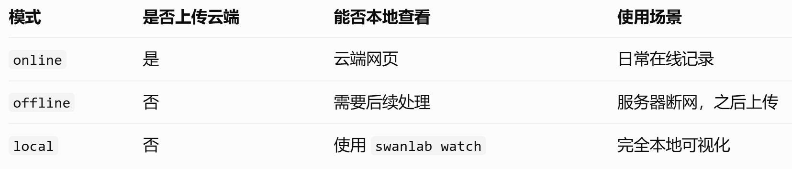
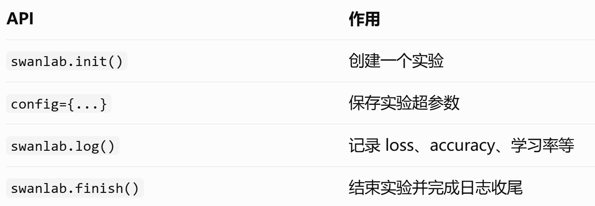
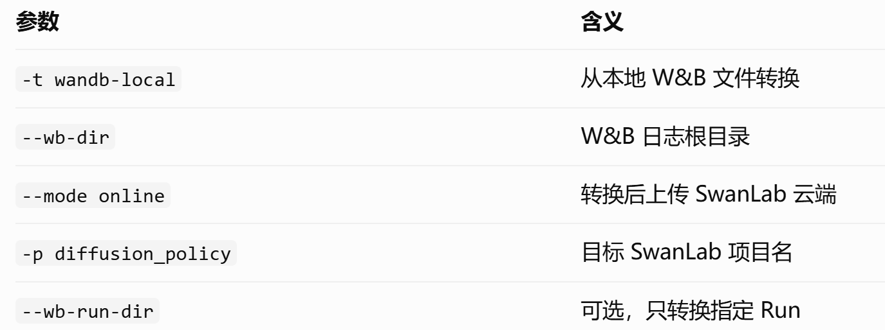

# 3种常用模式



- 服务器能访问 SwanLab：使用 `online`。
- 服务器不能访问 SwanLab，但希望之后上传：使用 `offline`。
- 不希望实验数据上传任何云端：使用 `local`。

---

# 新项目直接使用

## 安装SwanLab（在conda环境中）

```bash
conda activate your_env
python -m pip install swanlab
# 或直接pip安装
pip install swanlab
```

如果需要本地可视化看板，安装：

```bash
python -m pip install 'swanlab[dashboard]'
```

当前 SwanLab 0.10.3 支持 Python 3.9 及以上。

## 注册并登录

如果只使用 `local` 或 `offline` 模式，则不需要登录云端账户。

官网注册后在conda环境中：

```bash
swanlab login
```

输入api key即可。

## 在 Python 代码中记录训练日志

示例代码：

```python
import swanlab
# 1. 初始化实验
run = swanlab.init(
    project="my-research",
    experiment_name="experiment_001",
    config={
        "learning_rate": 1e-4,
        "batch_size": 32,
        "epochs": 100,
    },
    mode="online",
)
try:
    # 2. 训练循环
    for epoch in range(100):
        # 示例数据，替换成实际训练逻辑
        loss = 1.0 / (epoch + 1)
        lr = 1e-4
        # 3. 记录指标
        swanlab.log({
            "train/loss": loss,
            "train/lr": lr,
        }, step=epoch)
finally:
    # 4. [可选] 完成训练，这在notebook环境中是必要的
    swanlab.finish()
```

关键接口：



`step` 参数建议显式传入训练的 `global_step` 或 `epoch`，方便不同指标在同一横轴对齐。对于同一个指标，应避免在同一 step 重复记录不同值。SwanLab 会自动根据指标名称生成可视化曲线。

## 服务器没有网时：离线模式将日志保存在本地

`swanlab.init()`中的参数mode值改`"offline"`。训练结束后会生成 SwanLab 本地日志，默认位于当前运行目录下的 `swanlog`。

网络恢复后，登录swanlab并将日志传到云端：

```bash
swanlab login
swanlab sync ./swanlog/run-xxxx
# 批量上传
swanlab sync ./swanlog/run-*
```

`run-xxxx` 要替换为实际生成的实验文件夹名称。

## 本地查看实验

将代码`swanlab.init()`的参数改为本地模式`mode="local",`，

之后运行：

```
swanlab watch -l ./swanlog
```

浏览器访问：

`http://127.0.0.1:5092`

即可查看训练曲线。

如果 SwanLab 运行在远程 GPU 服务器上，可以从 Windows 建立 SSH 转发：

```
ssh -N -L 5092:127.0.0.1:5092 your-server
```

然后在 Windows 浏览器打开相同地址。

如果服务器需要经过跳板机或 Slurm 节点访问，则需要根据实际 SSH 路由调整转发。

SwanLab 官方说明，本地看板属于维护模式的旧功能，适合个人使用，但不再是主要开发方向。

---

# 使用Wandb的旧项目的迁移

SwanLab 官方提供了兼容接口`swanlab.sync_wandb()`，可以接管 W&B 的指标记录流程。在原项`wandb.init()`位置前增加代码：

```python
swanlab.sync_wandb(
    mode="online",    # 让 SwanLab 上传实验日志
    wandb_run=False,  # 阻止数据上传 W&B
)
```

同时`wandb.init()`中加一个参数`mode="offline",` ，进一步确保原有 W&B 逻辑不会要求访问其云端服务。

## 使用了 Hydra 配置参数的项目（如DP）

例如原代码：

```python
wandb.init(
    dir=str(self.output_dir),
    config=OmegaConf.to_container(cfg, resolve=True),
    **cfg.logging
)
```

则需要`wandb.init()`之前注册 SwanLab 兼容接口，并且在训练命令中明确加入`logging.mode=offline`，避免 Hydra 中原有的 `mode: online` 覆盖离线配置。

SwanLab 兼容接口应先在一个小型测试中验证，尤其要检查 W&B Run 是否还尝试连接官方 API，以及 SwanLab 是否正确记录了实验指标。

如果兼容层在旧项目中出现问题，直接替换 `wandb.init/log/finish` 为 SwanLab 原生接口会更稳定。

---

# Wandb历史日志的导入与查看

官方支持直接转换 W&B 本地日志，不需要先把日志上传到 W&B，也不需要从已经无法访问的 W&B 云端下载。

## wandb日志的保存目录

在某次训练输出目录（训练时通常会指定）中会有一个wandb文件夹，其中以`offline-run`”开头，中间包含日期和时间的文件夹是真正的日志文件夹。常见目录结构如下：

```
wandb/
├── offline-run-20261103_213000-abc123/
│   ├── files/
│   ├── logs/
│   ├── tmp/
│   └── run-abc123.wandb
├── offline-run-20261104_100000-def456/
│   ├── files/
│   └── run-def456.wandb
```

转换时要传入这个 `wandb/` 目录，而不是单个 `run-xxx.wandb` 文件。

## 安装日志转换工具

为了避免影响现有训练环境，可以单独创建一个 Conda 环境。

```bash
conda create -n logtools python=3.10 -y
conda activate logtools
python -m pip install 'swanlab[dashboard]'
```

这个新环境只用于转换和查看日志，不会影响原来的 PyTorch、CUDA 和其它依赖。

登录swanlab：`swanlab login`

## 上传W&B 本地日志到 SwanLab

```bash
swanlab convert \
  -t wandb-local \
  --wb-dir /path/to/wandb \
  --mode online \
  -p diffusion_policy
```

参数：



如果不指定 `--wb-run-dir`，工具会尝试转换该 W&B 根目录下的所有 Run。

参数`--mode offline`时则会将wandb日志转换为swanlab的日志文件并保存在本地，指定目录的参数`-l ./swanlog`。上传转换后的本地日志时仍然使`swanlab sync`命令，同前。

## 限制

SwanLab 官方目前说明，W&B 历史日志转换主要支持**标量图表**。

因此：

- loss、accuracy、success rate 等标量曲线适合迁移。
- 图片、视频、模型 Artifact 等不保证完整转换。
- 如果原始 W&B Run 没有完整保存、文件损坏或版本格式不兼容，可能无法恢复全部指标。

