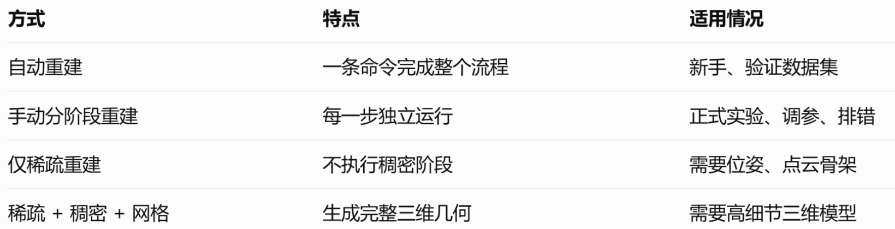
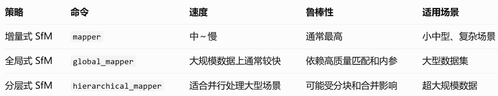
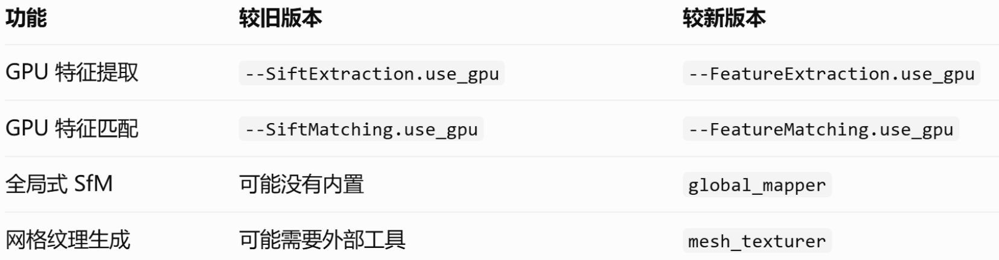
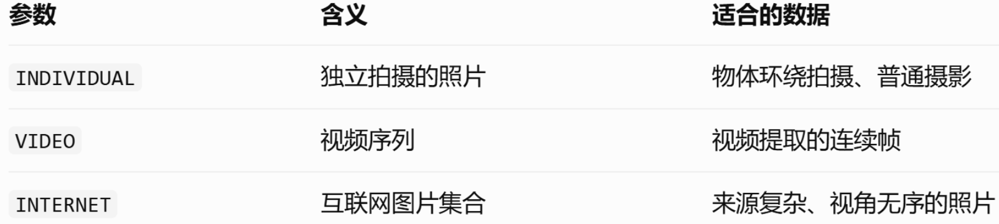
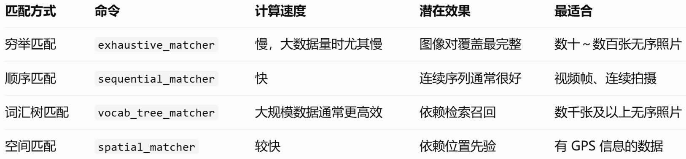
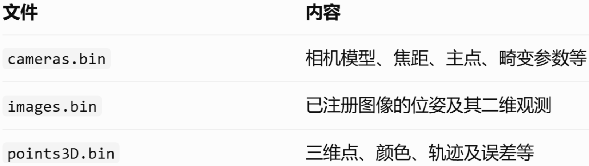
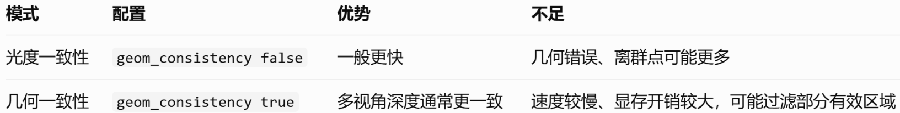

# 命令行的使用

前提：已经安装好colmap软件，根据是否有GPU安装对应版本

## 初步了解

### 完整流程的三个阶段

1. 稀疏重建 --> SfM + 相机位姿
2. 稠密重建 --> MVS + 稠密点云
3. 网格重建 --> Mesh 表面模型

根据自己不同的需要可以重建到不同的阶段，如3d高斯或Nerf一般只需要稀疏重建的结果。

### 重建分类

按操作流程区分：



按sfm算法区分：



## 检查colmap软件及其命令

```bash

# 查看可用命令

colmap -h

# 查看具体命令支持哪些参数

colmap feature_extractor -h

colmap mapper -h

```

特别注意：COLMAP 的不同版本，**参数名称**可能不同。例如：



具体使用哪个命令要根据自己版本的新旧确定。

## 准备图像数据

一般在根目录下创建一个文件`images`作为图片文件夹，里面只能放重建需要的图像。建议使用多视角照片而不是随意挑选的视频帧。拍摄时保证相邻照片存在足够重叠，避免严重运动模糊、反光，并让相机发生实际的空间移动，而不是只在原地旋转。

## 自动重建

### 命令

```bash

colmap automatic_reconstructor \

    --workspace_path /data/colmap_auto \

    --image_path /data/colmap_demo/images

```

这会自动完成特征提取、图像匹配、稀疏重建，以及配置支持时的稠密重建和网格生成。

在支持以下参数的版本中，可以明确选择重建设置：

```bash

colmap automatic_reconstructor \

    --workspace_path /data/colmap_auto \

    --image_path /data/colmap_demo/images \

    --quality HIGH \

    --data_type INDIVIDUAL

```

`--quality` 可以选择 `LOWMEDIUMHIGHEXTREME`。通常质量档位越高，计算和显存、内存开销越大，但最终效果不保证一定更好。

`--data_type` 主要区分：



新版本还可以用 `--mapper INCREMENTAL--mapper GLOBAL--mapper HIERARCHICAL` 选择 SfM 算法。

### 输出

产生的目录结构如下：

```txt

/data/colmap_auto/

├── database.db

├── sparse/

│   └── 0/

│       ├── cameras.bin

│       ├── images.bin

│       └── points3D.bin

└── dense/

    └── 0/

        ├── images/

        ├── sparse/

        ├── stereo/

        ├── fused.ply

        └── meshed-poisson.ply

```

实际文件取决于版本、所选选项，以及是否成功执行了稠密和网格阶段；部分版本还会包含 `rigs.binframes.bin`。

优点是简单、能够快速验证数据集是否可以重建；不足是各阶段的参数不便于单独控制，也不方便做算法对比实验。

## 手动分阶段重建

流程示意：

1. 原始图像 --> `images/`
2. 特征提取（Feature Extraction） --> 检测 SIFT 等局部特征
3. 特征匹配（Feature Matching） --> 确定图像间的对应关系
4. SfM：稀疏重建 --> 相机位姿 + 稀疏点云
5. 图像去畸变 + PatchMatch MVS --> 深度图 / 法线图
6. Stereo Fusion：稠密点云融合 --> `fused.ply`
7. Mesh Reconstruction：网格重建 --> `meshed-poisson.ply` 等

### Step 1：提取图像特征

```bash

colmap feature_extractor \

    --database_path "/data/colmap_demo/database.db" \

    --image_path "/data/colmap_demo/images" \

    --[ImageReader.camera](http://ImageReader.camera)_model SIMPLE_RADIAL

```

这条命令主要完成：

- 读取全部图像和相机信息。
- 提取局部特征点和描述子（默认通常为 SIFT）。
- 将相关信息写入 SQLite 数据库 `database.db`。

`SIMPLE_RADIAL` 是标准镜头的常用起点。如果所有图片都来自同一个相机，并且镜头、焦距、图像尺寸等设置相同，可以追加：

```

--ImageReader.single_camera 1

```

共享相机内参通常有利于稳定标定，但不适合由不同镜头、不同变焦设置混合而成的照片。

对于预先去畸变的图像，可以考虑 `PINHOLE`；对于具有明显畸变的镜头，可以考虑 `OPENCV` 或鱼眼相机模型。

> ❗ 注意：3d高斯不适`RADIAL`模型，最好使`PINHOLE`或 `SIMPLE_PINHOLE`

#### 可能出现的问题

**报错：**

```

Shader not supported by your hardware!

ERROR: SiftGPU not fully supported.

...

```

apt安装的预编译版本默认启用SiftGPU，但显卡可能不支持对应的Shader，导致特征提取/匹配步骤完全失败，数据库里没有生成任何匹配数据。

**解决方法：**

可以强制COLMAP使用CPU版本的SIFT特征提取，避开SiftGPU的兼容性问题：

- 特征提取命令添加参`--SiftExtraction.use_gpu 0`
- 特征匹配命令添加参`--SiftMatching.use_gpu 0`

### Step 2：选择图像特征匹配方式

四种常用匹配方式对比：



#### 穷举匹配（建议新手首先使用）

```bash

colmap exhaustive_matcher \

    --database_path "/data/colmap_demo/database.db"

```

#### 顺序匹配（视频帧推荐）

```bash

colmap sequential_matcher \

    --database_path "/data/colmap_demo/database.db" \

    --SequentialMatching.overlap 10

```

`overlap 10` 表示考虑相邻范围内的图像配对，不代表 10% 的像素重叠率。图片文件名应当能够正确反映时间顺序，例如 `000001.jpg000002.jpg`。对于回环拍摄的视频，建议进一步配置词汇树回环检测。

#### 词汇树匹配（大规模无序图像）

```bash

colmap vocab_tree_matcher \

    --database_path "/data/colmap_demo/database.db" \

    --VocabTreeMatching.vocab_tree_path /path/to/vocab_tree.bin

```

需要事先准备词汇树文件，可以从 [COLMAP 相关资源页面]([https://demuc.de/colmap/?utm_source=chatgpt.com](https://demuc.de/colmap/?utm_source=chatgpt.com)) 下载预训练词汇树。

#### 空间匹配（已知 GPS 位置）

```bash

colmap spatial_matcher \

    --database_path "/data/colmap_demo/database.db"

```

根据相机先验位置选择邻近图像进行匹配。如果不存在有效的位置信息，不建议直接用它替代穷举匹配。

> ❗ 在上述四种方法中，选择一种执行就可以，不需要依次运行全部四条。

### Step 3：进行稀疏重建

```bash

mkdir -p "/data/colmap_demo/sparse"

colmap mapper \

    --database_path "/data/colmap_demo/database.db" \

    --image_path "/data/colmap_demo/images" \

    --output_path "/data/colmap_demo/sparse"

```

运行成功后得到的目录结构：

```bash

sparse/

└── 0/

    ├── cameras.bin

    ├── images.bin

    └── points3D.bin

```

各文件含义：



新版本可能另外生成 `rigs.bin` 和 `frames.bin`。

如果 `sparse` 中包含 `012` 等多个目录，代表 COLMAP 得到了多个独立的重建模型，并不意味着 `0` 一定是最佳结果。

可以使用下面的命令分析第一个模型：

```bash

colmap model_analyzer \

    --path "/data/colmap_demo/sparse/0"

```

重点关注注册图像数量、三维点数以及平均重投影误差。

> ❗ 3d高斯或Nerf到这一步就足够了。

### Step 4：图像去畸变

```bash

mkdir -p "/data/colmap_demo/dense"

colmap image_undistorter \

    --image_path "/data/colmap_demo/images" \

    --input_path "/data/colmap_demo/sparse/0" \

    --output_path "/data/colmap_demo/dense" \

    --output_type COLMAP \

    --max_image_size 2000

```

`--max_image_size 2000` 用于限制去畸变后图像的最大尺寸，有助于控制计算开销。调大通常可以保留更多细节，但会增加显存、内存和运行时间。

输出大致为：

```

dense/

├── images/

├── sparse/

└── stereo/

```

### Step 5：PatchMatch 稠密立体匹配

```bash

colmap patch_match_stereo \

    --workspace_path "/data/colmap_demo/dense" \

    --workspace_format COLMAP \

    --PatchMatchStereo.geom_consistency true

```

这是稠密重建中通常最耗计算资源的部分。它会根据多个视角图像估计每张图像的深度图和法线图。这里还有两种重要的重建模式：



对于想要高质量几何结果的场景，建议从 `true` 开始。对速度要求较高时，可以尝试 `false`。

### Step 6：融合稠密点云

```bash

colmap stereo_fusion \

    --workspace_path "/data/colmap_demo/dense" \

    --workspace_format COLMAP \

    --input_type geometric \

    --output_path "/data/colmap_demo/dense/fused.ply"

```

`geometric` 对应前面启用了几何一致性的结果。如果前面选择了 `geom_consistency false`，这一阶段应改`--input_type photometric`。

得到`dense/fused.ply`就是彩色稠密点云。

建议将两种实验放在不同的 `dense` 工作目录中，避免深度结果混在一起，影响对比。

### Step 7：将点云重建为三角网格

COLMAP 有两种经典的网格重建算法。

方式 A：Poisson 网格重建

```

colmap poisson_mesher \

    --input_path "/data/colmap_demo/dense/fused.ply" \

    --output_path "/data/colmap_demo/dense/meshed-poisson.ply"

```

方式 B：Delaunay 网格重建

```

colmap delaunay_mesher \

    --input_path "/data/colmap_demo/dense" \

    --output_path "/data/colmap_demo/dense/meshed-delaunay.ply"

```

两种方法的效果有明显区别：

| 对比项 | Poisson | Delaunay |

|---|---|---|

| 表面平滑性 | 通常更高 | 通常较低 |

| 细节表现 | 可能过度平滑 | 可能更好保留尖锐边界 |

| 离群点鲁棒性 | 对噪声较敏感 | 通常较好 |

| 空洞区域 | 容易生成补面 | 更依赖可见性约束 |

| 大规模场景 | 可能需要大量内存 | 一般更容易扩展 |

| 适用对象 | 连续表面、雕塑、物体 | 建筑、户外、结构复杂场景 |

官方文档也强调 Poisson 往往需要比较干净的点云，而 Delaunay 对离群点更鲁棒，但通常不如 Poisson 光滑。如果版本支持，还可以试验 `advancing_front_mesher`，用于基于可见性约束的表面生成。

对于新版 COLMAP，完成网格后还可以执行纹理生成：

```

colmap mesh_texturer \

    --workspace_path "/data/colmap_demo/dense" \

    --input_path "/data/colmap_demo/dense/meshed-poisson.ply" \

    --output_path "/data/colmap_demo/dense/textured"

```

这一步将多视角照片映射到三角网格表面，生成带纹理的几何资产。旧版本若没有 `mesh_texturer` 命令，可以使用其他纹理映射工具。

---

# 图形界面的使用

